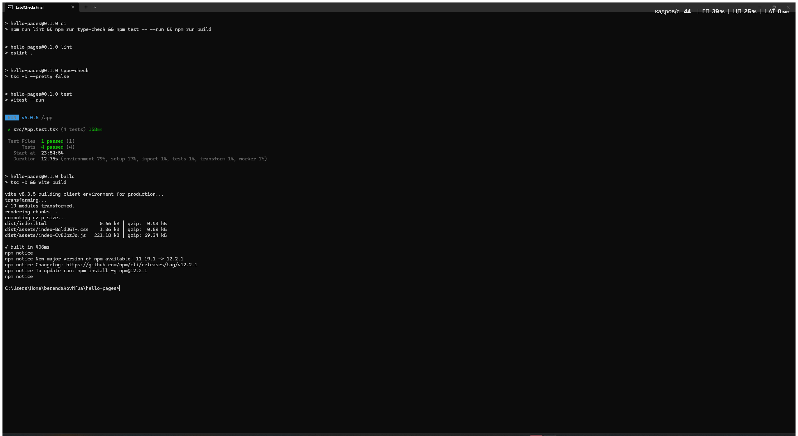
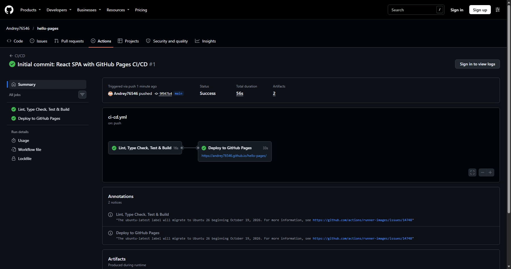

# Лабораторная работа №3 — CI/CD на GitHub Pages

[](https://github.com/Andrey76546/hello-pages/actions/workflows/ci-cd.yml)

## Цель

Реализовать React SPA и полный Continuous Deployment: каждый push в `main` проходит линтинг, проверку типов, тесты и production-сборку, после чего проверенный артефакт автоматически публикуется на GitHub Pages.

## Выполнено

- создан React + TypeScript + Vite проект с компонентами `Header`, `About` и `Projects`;
- добавлены адаптивные стили и четыре Vitest/Testing Library теста;
- настроены ESLint и строгая проверка TypeScript;
- задан обязательный Vite base path `/hello-pages/`;
- CI сохраняет `dist` как артефакт и проверяет пути в `dist/index.html`;
- deploy-job зависит от CI через `needs: ci`, не пересобирает приложение и публикует скачанный артефакт;
- деплой привязан к Environment `github-pages` и выполняется только для push в `main`.

## Технологии

React 19, TypeScript 6, Vite 8, Vitest 5, Testing Library, ESLint 10, Node.js 24, GitHub Actions, GitHub Pages.

## Структура проекта

```text
hello-pages/
├── .github/workflows/ci-cd.yml
├── public/favicon.svg
├── screenshots/
│   ├── 01-checks.png
│   ├── 02-github-actions.png
│   └── 03-site.png
├── src/
│   ├── components/
│   │   ├── About.tsx
│   │   ├── Header.tsx
│   │   └── Projects.tsx
│   ├── App.test.tsx
│   ├── App.tsx
│   ├── index.css
│   ├── main.tsx
│   ├── setupTests.ts
│   └── vite-env.d.ts
├── .gitignore
├── eslint.config.js
├── index.html
├── package-lock.json
├── package.json
├── tsconfig.app.json
├── tsconfig.json
├── tsconfig.node.json
└── vite.config.ts
```

## Локальный запуск и проверки

Требуется Node.js 24 или официальный Docker-образ Node:

```powershell
npm ci
npm run lint
npm run type-check
npm test -- --run
npm run build
npm run ci
npm run dev
```

Эквивалентная проверка в Docker:

```powershell
docker run --rm -e HOME=/tmp -v "${PWD}:/app" -w /app node:24-alpine `
  sh -c "npm ci && npm run lint && npm run type-check && npm test -- --run && npm run build"
```

После сборки `dist/index.html` должен содержать пути вида `/hello-pages/assets/...`.

## CI/CD и публикация

- [Все запуски CI/CD](https://github.com/Andrey76546/hello-pages/actions/workflows/ci-cd.yml)
- [Контрольный успешный CI/CD Deploy](https://github.com/Andrey76546/hello-pages/actions/runs/40790687827)
- [Deployments](https://github.com/Andrey76546/hello-pages/deployments)
- [Environment github-pages](https://github.com/Andrey76546/hello-pages/settings/environments)
- [Опубликованный сайт](https://andrey76546.github.io/hello-pages/)

Порядок выполнения:

```text
push в main → ci (lint → types → tests → build) → deploy → GitHub Pages
```

Если любая CI-проверка завершается ошибкой, `deploy` не запускается.

## Результаты и доказательства

### Локальные проверки и production-сборка



Все проверки выполнены на чистой установке зависимостей; production-сборка содержит корректный base path.

### GitHub Actions



Job `Deploy to GitHub Pages` запущен только после успешного `Lint, Type Check, Test & Build`.

### Работающий сайт


Страница загружена с публичного URL GitHub Pages; стили и JavaScript работают с префиксом `/hello-pages/`.

## Вывод

Реализован настоящий Continuous Deployment: один workflow проверяет код, передаёт неизменённый build-артефакт и автоматически публикует работающий React-сайт в окружение GitHub Pages.
